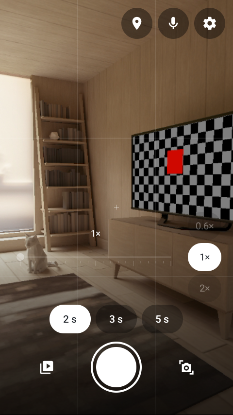
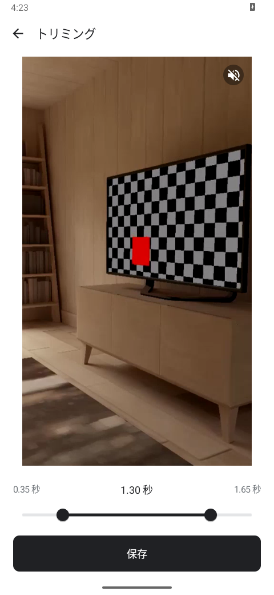
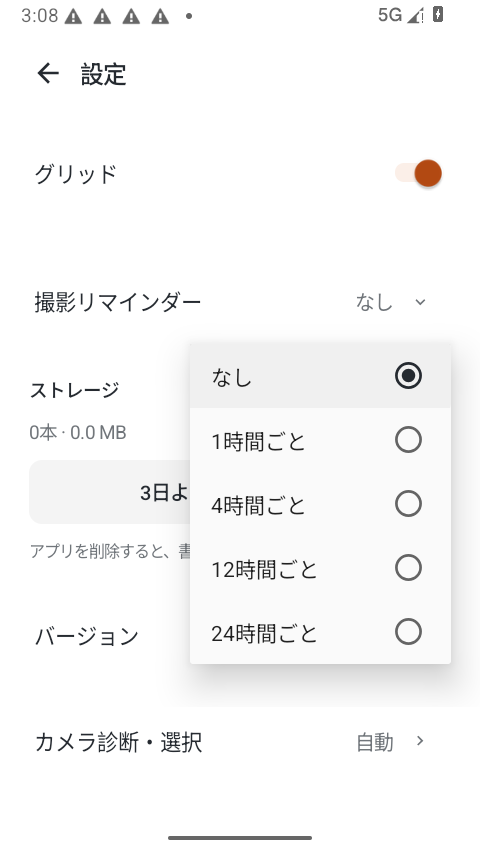

# flint.

短い動画を撮って、1日分の Vlog にまとめる Android アプリです。2・3・5秒の動画に文字や場所を添えて、日常や旅行の記録を残せます。

**Android 16 以上対応。アカウント登録は不要です。** 撮影したクリップと編集内容は端末内に保存されます。

[公開版の APK をダウンロード](https://github.com/sasakiy84/solo-vlog-android/releases/latest)

## 画面

| 撮影 | トリミング | 通知設定 |
| --- | --- | --- |
|  |  |  |

画面はエミュレーターで撮影した例で、映像は仮想シーンです。開発中の画面を含むため、公開版とは一部異なります。

## できること

- **短く撮る** — 撮影画面で2・3・5秒を切り替え。倍率もボタンとスライダーで調整できます。
- **文字と場所を添える** — 撮影直後にクリップのテキストや場所を追加。年月日・撮影時刻の表示も選べます。
- **クリップを整える** — 元の動画を残したままトリミングし、クリップごとに書き出す音声をオン・オフ。撮り直しや単体保存にも対応します。
- **1日分をまとめる** — 使うクリップを選び、1日を通して表示するテキストを追加。文字や場所の表示、音声の有無を調整してレンダリングできます。
- **確認して保存する** — レンダリングと端末への保存は別々。完成動画をプレビューしてから保存できます。保存名は日付が初期値で、変更もできます。
- **容量を空ける** — 保存した完成動画を残して、3日より前のクリップや編集データをまとめて削除できます。

## 使い方

1. 倍率と長さを選んで撮影します。
2. 文字や場所を選び「保存」。あとから編集する場合は、一覧のクリップを長押しします。
3. その日のクリップを選び、1日のテキストや表示内容を調整してレンダリングします。
4. プレビューと保存名を確認して「保存」。保存後は「開く」から再生できます。

完成動画は端末の `Movies/Daylog` に保存されます。同じ保存名の動画がある場合は上書きします。

## 設定

縦・横の向き、画質、明るさの自動調整、利き手、1日の切り替え時刻を変更できます。容量優先の書き出しや、位置情報の記録・埋め込みも選べます。

撮影リマインダーは **なし・1時間ごと・4時間ごと・12時間ごと・24時間ごと** の5択。通知を使うときに権限を確認します。

カメラを切り替えたい場合は、設定の「カメラ診断・選択」で試し撮り・再生してから適用できます。利用できる倍率や画質は端末によって異なります。

## 名前について

名前は発火石（flint）に由来します。「火花を散らす一瞬のきっかけ」と、「石という、固く残るもの」。ロゴは石の割れ目と、オレンジの断面を表しています。
